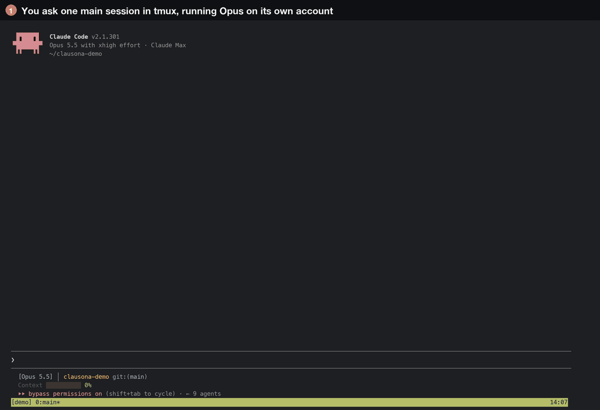

# Run a tmux fleet across your accounts



[tmux](https://github.com/tmux/tmux) keeps terminal sessions running and splits them into
windows. clausona gives each Claude Code or Codex session in those windows its own account. With
both, one Claude Code or Codex session in a tmux pane can split a job across several workers,
each in its own window on a different account or an API model, and you can switch to any
worker's window and type into it.

It needs no GUI, only tmux, so it also works on a remote machine over SSH.

The `tmux-fleet` plugin from this repo teaches the coordinating session how to do it. The same
pattern runs in [Superset](superset-fleet.md), [herdr](herdr-fleet.md) and [Orca](orca-fleet.md).

## Why not subagents?

Subagents run inside one session, out of sight, on that session's account. A tmux worker is an
ordinary Claude Code or Codex session in its own window and git worktree, on the account you
pick. The [parallel agents guide](https://larcane97.github.io/clausona/guides/parallel-claude-code-agents/)
has the longer version.

## How it fits together

1. **It picks the profiles.** It uses the profiles and rules you give it, in the request or in
   `~/.clausona/fleet.json`. For the rest it reads every profile's limits with `clausona list`,
   picks profiles of its own tool with headroom, and never uses its own.
2. **It starts the workers.** For each task it adds a git worktree at
   `~/.clausona/worktrees/<repo>/<task>` on branch `fleet/<task>`. Then it opens a window in the
   same tmux session, labelled `<task> · <profile>`, and types `clausona run <profile> -- …`
   into that window's shell. The status bar lists the windows.
3. **It watches them.** tmux cannot tell what an agent is doing, so each worker reports it. A
   Claude Code worker gets hooks for that worker only, through `--settings` pointing at
   `.fleet-claude.json` in its worktree. Your shared settings.json is not touched. A Codex worker
   is told to ring the terminal bell when it waits for approval or ends a turn, and a tmux bell
   hook on its window records it. Both write to `.fleet-events.jsonl` in the worktree, and the
   orchestrator waits on those events with `tmux-fleet.mjs`, a small Node script that ships with
   the plugin.
4. **It checks and retires.** When a worker says it is done, the orchestrator checks the branch
   itself. Then it runs `git worktree remove` and closes the window, after asking you (the
   default) or automatically. The branch stays.

## Setup

1. **Add your profiles to clausona.** [Install clausona](../../README.md#install), then
   `clausona add claude:work` per account, or an API model such as
   `clausona add claude:glm --api --base-url https://openrouter.ai/api --model z-ai/glm-5.3`.
2. **Have tmux 3.2 or newer** (`tmux -V` prints the version). It runs on macOS, Linux and WSL.
3. **Install the plugin.** clausona shares plugins across profiles, so one install reaches every
   profile:

   ```bash
   claude plugin marketplace add larcane97/clausona
   claude plugin install tmux-fleet@clausona      # fleet-core comes along
   ```

   In Codex, which has no plugin dependencies, add `fleet-core` yourself:

   ```bash
   codex plugin marketplace add larcane97/clausona
   codex plugin add fleet-core@clausona
   codex plugin add tmux-fleet@clausona
   ```

4. **Start each new profile once by hand** (`clausona run claude:work`). Its first session can ask
   one-time questions, and a worker would wait at them.

## A run

Start tmux, open Claude Code or Codex in your repo inside it, and ask:

> Split these across my accounts in tmux: add a `--json` flag to `notes list`, and write tests
> for `src/parse.ts`.

The orchestrator shows a table of tasks and profiles. When neither your request nor your settings
named a profile, it waits for your OK. Then it starts the workers, reads each as it finishes,
checks the branches, and tells you what it checked and what the worker only claimed.

Each worker sits in its own window. Press your tmux prefix and the window's number to watch it or
type into it.

Things it handles on the way:

- **Folder trust.** Claude Code and Codex ask once per repository (Claude Code once per profile
  too) whether to trust it. The orchestrator reads the worker's screen and answers with keys, for
  the repo you asked it to work on and nothing else.
- **Account limits.** If a worker stops at a usage limit, the orchestrator opens a new pane in
  that worker's window on another profile, hands the task over, and closes the old pane.
- **A missed signal.** If a worker that is working prints nothing for three minutes and no event
  arrives, the wait wakes up anyway. One lost signal does not hang the run.
- **Worker files.** Briefs and follow-ups go in `.fleet-*.md` files in the worktree. Every
  `.fleet-*` file is listed in the repo's `.git/info/exclude`, so none of them is ever committed.
- **Retiring.** It retires a worker only after the branch is pushed and the worktree is clean, and
  it runs `git worktree remove` without `--force`. git refuses a worktree with changes, and then
  the worker is kept.

## Settings

The same `~/.clausona/fleet.json` as the other fleet plugins: `workers`, `routing`, `maxUsage`,
`retire` and `permissions`. See [the Superset page](superset-fleet.md#settings) for each key.

## Codex

- A Codex session can be the orchestrator. It waits for workers a few minutes at a time, since
  Codex has no background tasks that wake it.
- Workers use the orchestrator's tool. A Codex worker in a Claude Code fleet, or the other way
  round, runs only when you name that profile or list it in `workers`.
- Codex workers start with `--disable hooks`, so they never stop at Codex's "Hooks need review"
  screen. Trusting hooks stays your call.
- In Codex's default `workspace-write` sandbox, `.git` is read-only and there is no network, so a
  Codex worker asks before it commits and again before it pushes. The orchestrator never answers
  those prompts: it tells you which worker waits, and you approve in that worker's window. To let
  Codex workers commit and push on their own, set `"codexSandbox": "danger-full-access"` under
  `permissions`, which turns Codex's sandbox off for them.
- If your Codex config has `[shell_environment_policy] inherit = "core"` (or `"none"`), Codex
  hides `TMUX` from the commands it runs, and the orchestrator cannot reach tmux. Start that
  Codex session with `-c shell_environment_policy.inherit=all`.

## Limits

- The orchestrator must run inside a tmux pane. It finds its session through `$TMUX`.
- tmux 3.2 or newer, on macOS, Linux or WSL. tmux does not run natively on Windows.
- tmux cannot tell an agent's state by itself, so the plugin relies on what each worker reports,
  with the three-minute quiet check as a fallback.
- If your tmux has `bell-action none` or `current`, Codex workers are noticed only by that quiet
  check.
